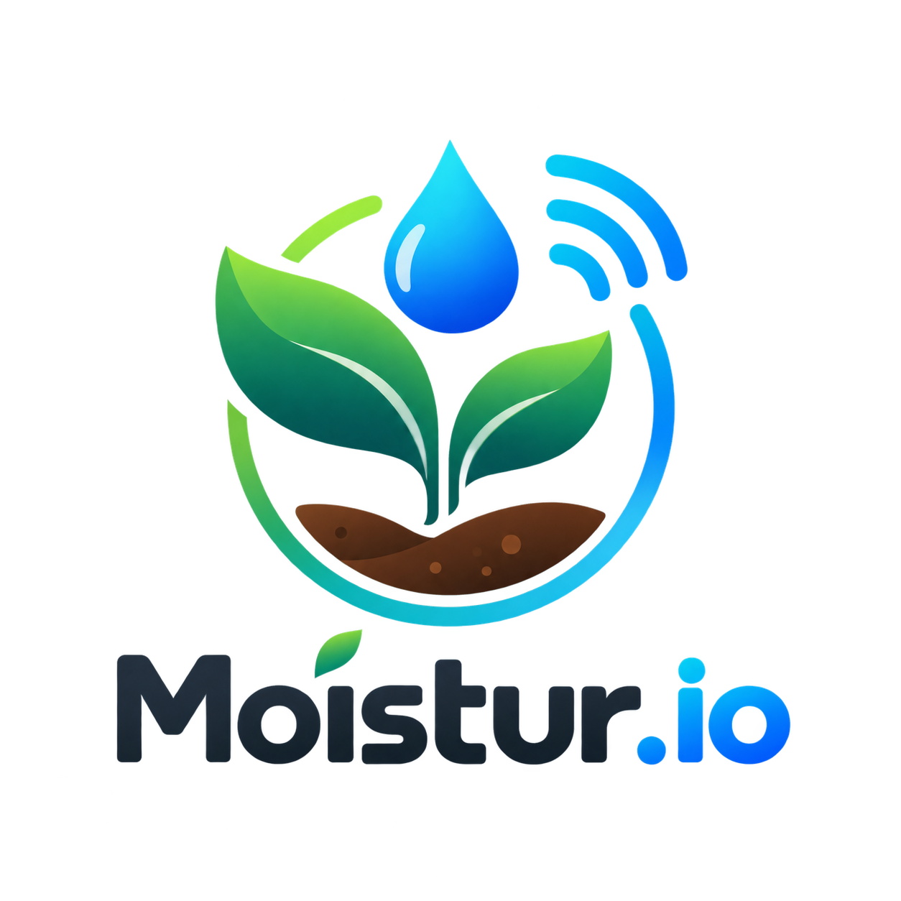
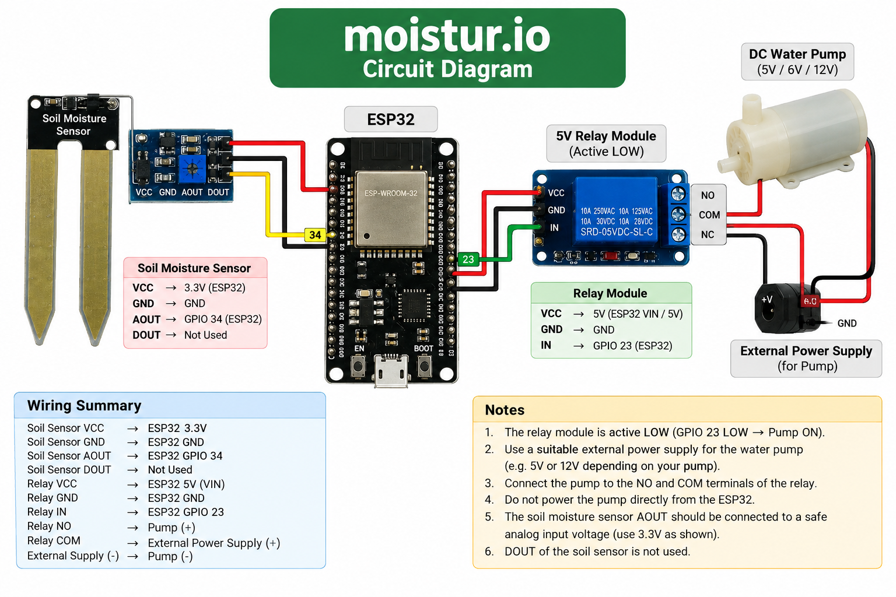
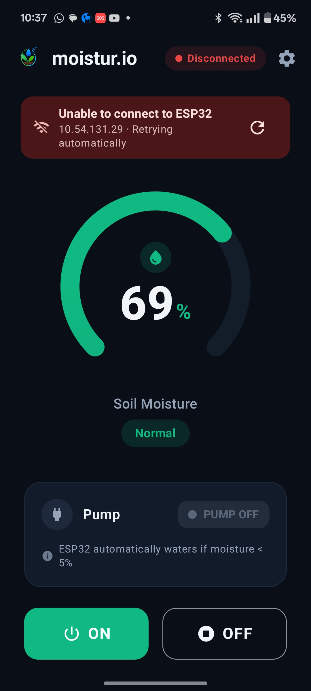
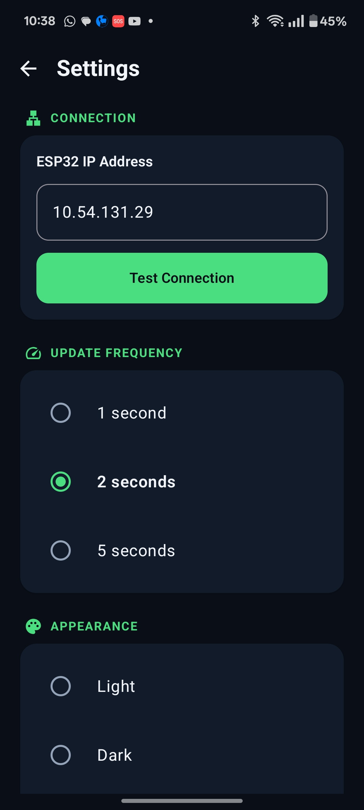

# 🌱 moistur.io

## Smart IoT-Based Automatic Plant Watering System

<p align="center">
  
</p>

<p align="center">
  <b>"Smarter care and greener tomorrow"</b>
</p>

<p align="center">
  An ESP32-based smart plant watering system with soil moisture monitoring,
  automatic watering, web control, and Android app integration.
</p>

---

## 📌 Overview

**moistur.io** is an IoT-based smart plant watering system designed to automatically monitor soil moisture and water plants when the soil becomes too dry.

The system uses an **ESP32**, **soil moisture sensor**, **relay module**, and **DC water pump**.

An Android application and ESP32 web dashboard allow the user to monitor soil moisture and manually control the pump.

The automatic watering system works independently of the Android application.

---

## ✨ Features

- 🌱 Real-time soil moisture monitoring
- 💧 Automatic plant watering
- 📊 Soil moisture percentage display
- ⚙️ Automatic watering below **5% moisture**
- ⏱️ Automatic pump operation for **4 seconds**
- 📱 Android application
- 🌐 ESP32 web dashboard
- 🔘 Manual pump ON/OFF control
- 📡 Local Wi-Fi communication
- 🔌 HTTP API
- 🌙 Light/Dark theme in Android app
- 📱 ESP32 IP configuration
- 🔄 Automatic sensor data updates
- 🧠 Automatic watering handled directly by ESP32

---

# 📸 Project Gallery

## 🔌 Circuit Diagram

<p align="center">
  
</p>

The circuit diagram shows the connections between the ESP32, soil moisture sensor, relay module, and water pump.

---

## 📱 Android Application

### Dashboard

<p align="center">
  
</p>

The Android application displays:

- Soil moisture percentage
- Pump status
- Manual pump controls
- ESP32 connection status

### App Interface

<p align="center">
  
</p>

The application also provides ESP32 connection settings and theme customization.

---

# 🧩 Components Used

| Component | Quantity | Purpose |
|---|---:|---|
| ESP32 Development Board | 1 | Main controller |
| Soil Moisture Sensor | 1 | Measures soil moisture |
| Relay Module | 1 | Controls the water pump |
| DC Water Pump | 1 | Waters the plant |
| External Power Supply | 1 | Powers the pump |
| Jumper Wires | As required | Electrical connections |
| Water Container | 1 | Water reservoir |
| Plant & Soil | 1 | Testing |
| USB Cable | 1 | ESP32 programming |

---

# ⚙️ How It Works

The ESP32 continuously measures the moisture level of the soil.

```text
        🌱 SOIL
           │
           ▼
┌────────────────────┐
│ Soil Moisture      │
│ Sensor             │
└─────────┬──────────┘
          │
          │ Analog Signal
          ▼
┌────────────────────┐
│       ESP32        │
│                    │
│ Sensor Reading     │
│ Automatic Control  │
│ Wi-Fi              │
│ HTTP Server        │
└────────┬──────┬────┘
         │      │
       GPIO    Wi-Fi
         │      │
         ▼      ▼
    ┌───────┐ ┌─────────────┐
    │ Relay │ │ Android App │
    └───┬───┘ └─────────────┘
        │
        ▼
     💧 Pump
        │
        ▼
      🌱 Plant
```

---

# 💧 Automatic Watering

The ESP32 automatically controls the pump.

### Current configuration

```text
Automatic moisture threshold: 5%
Automatic pump duration: 4 seconds (4000 ms)
```

When the soil moisture falls below 5%:

```text
Moisture < 5%
      ↓
   Pump ON
      ↓
  4 seconds
      ↓
   Pump OFF
```

The ESP32 then continues monitoring the soil.

The system prevents repeated automatic watering cycles while the soil remains below the threshold.

---

# 🎮 Manual Pump Control

The pump can also be controlled manually using:

- Android application
- ESP32 web dashboard

### Turn ON

```http
GET /pump/on
```

### Turn OFF

```http
GET /pump/off
```

Manual pump control is independent of the automatic 4-second watering timer.

---

# 🔌 Circuit Connections

## Soil Moisture Sensor → ESP32

| Sensor Pin | ESP32 |
|---|---|
| VCC | 3.3V |
| GND | GND |
| AOUT | GPIO 34 |
| DOUT | Not Used |

```text
Soil Moisture Sensor

VCC  ────────── ESP32 3.3V
GND  ────────── ESP32 GND
AOUT ────────── ESP32 GPIO 34
DOUT ────────── Not Used
```

---

## Relay → ESP32

| Relay Pin | ESP32 |
|---|---|
| VCC | 5V / VIN |
| GND | GND |
| IN | GPIO 23 |

The relay is configured as **active LOW**.

```text
GPIO 23 LOW  → Pump ON
GPIO 23 HIGH → Pump OFF
```

---

# 💧 Pump Wiring

The water pump should be powered using a suitable external power supply.

```text
External PSU (+)
       │
       ▼
    Relay COM
       │
       ▼
     Relay NO
       │
       ▼
    Pump (+)

    Pump (-)
       │
       ▼
External PSU (-)
```

The **NO (Normally Open)** terminal is used so that the pump remains OFF when the relay is inactive.

> ⚠️ **Do not power the water pump directly from an ESP32 GPIO pin.**

---

# 📡 Wi-Fi Connectivity

The ESP32 connects to the local Wi-Fi network using DHCP.

```cpp
WiFi.mode(WIFI_STA);
WiFi.begin(WIFI_SSID, WIFI_PASSWORD);
```

The network automatically assigns an IP address to the ESP32.

The IP address can be viewed in the Arduino Serial Monitor.

Example:

```text
Wi-Fi CONNECTED!

SSID: YOUR_WIFI_NAME
ESP32 IP: 192.168.1.XX

HTTP server started!
Ready.
```

---

# 🌐 Web Dashboard

The ESP32 contains a built-in web dashboard.

Open:

```text
http://ESP32-IP/
```

For example:

```text
http://192.168.1.25/
```

Replace the IP address with the actual address shown by the ESP32.

The dashboard provides:

- 🌱 Soil moisture
- 📊 Raw sensor value
- 💧 Pump status
- 🟢 Pump ON button
- 🔴 Pump OFF button

---

# 🔗 HTTP API

The ESP32 provides a simple HTTP API.

| Endpoint | Method | Function |
|---|---|---|
| `/` | GET | Web dashboard |
| `/data` | GET | Sensor data |
| `/pump/on` | GET | Turn pump ON |
| `/pump/off` | GET | Turn pump OFF |

---

## `/data`

Request:

```http
GET /data
```

Example response:

```json
{
  "moisture": 63,
  "raw": 1850,
  "pump": false
}
```

### Response Parameters

| Parameter | Type | Description |
|---|---|---|
| `moisture` | Integer | Soil moisture percentage |
| `raw` | Integer | Raw ADC sensor value |
| `pump` | Boolean | Current pump state |

---

## `/pump/on`

```http
GET /pump/on
```

Example response:

```json
{
  "success": true,
  "pump": true
}
```

---

## `/pump/off`

```http
GET /pump/off
```

Example response:

```json
{
  "success": true,
  "pump": false
}
```

---

# 📱 Android Application

The **moistur.io Android application** provides a graphical interface for interacting with the ESP32.

### Main Features

- 🌱 Soil moisture meter
- 💧 Pump status
- 🔘 Manual ON/OFF controls
- 📡 ESP32 connection status
- 🌐 ESP32 IP configuration
- 🔌 Test Connection
- 🌙 Dark theme
- ☀️ Light theme
- 🔄 Periodic sensor updates

---

# 🤖 Android App Development

The Android application was developed with the assistance of **Google AI Studio**.

Google AI Studio was used to assist with:

- Android application code
- UI structure
- Application implementation
- Project setup

> **Android Application: Developed with Google AI Studio**

---

# 💻 ESP32 Firmware

The ESP32 firmware is located in:

```text
ESP32/
└── moistur_io.ino
```

The firmware is responsible for:

- Reading the soil moisture sensor
- Calculating moisture percentage
- Automatic watering
- Pump control
- Wi-Fi connection
- HTTP server
- Web dashboard
- API endpoints

---

# 📱 Android Project

The Android application is located in:

```text
Android/
└── ...
```

The Android app communicates with the ESP32 through HTTP over the local Wi-Fi network.

---

# 📁 Project Structure

```text
moistur.io/
│
├── ESP32/
│   └── moistur_io.ino
│
├── Android/
│   └── ...
│
├── images/
│   ├── logo.png
│   ├── circuit-diagram.png
│   ├── app-dashboard.jpg
│   └── app-interface.jpg
│
├── docs/
│   └── project-report.pdf
│
├── README.md
├── LICENSE
└── .gitignore
```

---

# 🚀 Installation

## 1. ESP32 Setup

Open:

```text
ESP32/moistur_io.ino
```

using Arduino IDE.

Configure your Wi-Fi credentials:

```cpp
const char* WIFI_SSID = "YOUR_WIFI_NAME";
const char* WIFI_PASSWORD = "YOUR_WIFI_PASSWORD";
```

Upload the firmware to the ESP32.

---

## 2. Find ESP32 IP Address

Open the Arduino Serial Monitor.

Set the baud rate to:

```text
115200
```

After connecting to Wi-Fi, the ESP32 will display its IP address.

Example:

```text
ESP32 IP: 192.168.1.25
```

---

## 3. Open Web Dashboard

Open the IP address in a browser:

```text
http://192.168.1.25/
```

Replace the IP with the address shown by your ESP32.

---

## 4. Android Application

Open the Android project using Android Studio.

Enter the ESP32 IP address in the moistur.io application.

Press:

```text
Test Connection
```

The application should connect when the Android device and ESP32 are connected to the same local network.

---

# 🌱 Soil Moisture Calibration

The current calibration values are:

```cpp
const int DRY_VALUE = 3000;
const int WET_VALUE = 1200;
```

Approximate mapping:

```text
DRY_VALUE → 0%

WET_VALUE → 100%
```

The actual values may vary depending on:

- Soil type
- Sensor type
- Sensor placement
- Soil density
- Environmental conditions

Calibration should therefore be performed using the actual sensor and soil.

---

# 📊 Project Parameters

| Parameter | Value |
|---|---|
| Project Name | moistur.io |
| Controller | ESP32 |
| Soil Sensor | Analog Soil Moisture Sensor |
| Soil Sensor Pin | GPIO 34 |
| Relay Pin | GPIO 23 |
| Communication | Wi-Fi |
| Protocol | HTTP |
| Network Mode | DHCP |
| Automatic Threshold | < 5% |
| Automatic Pump Duration | 4 seconds (4000 ms) |
| Dry Calibration | 3000 |
| Wet Calibration | 1200 |
| Relay Logic | Active LOW |
| Android Application | moistur.io |

---

# 🧪 Testing

| Test | Expected Result |
|---|---|
| ESP32 powered ON | ESP32 starts |
| Wi-Fi connection | IP address received |
| Soil sensor connected | ADC value available |
| Dry soil | Moisture decreases |
| Wet soil | Moisture increases |
| Moisture < 5% | Pump automatically starts |
| Automatic watering | Pump runs for 4 seconds |
| After 4 seconds | Pump turns OFF |
| Manual ON | Pump turns ON |
| Manual OFF | Pump turns OFF |
| `/data` | JSON data returned |
| Web dashboard | Dashboard loads |
| Android app | ESP32 connection succeeds |

---

# ⚠️ Safety

This project involves water and electrical components.

- Do not power the pump directly from an ESP32 GPIO.
- Use a suitable external power supply for the pump.
- Keep water away from the ESP32 and relay connections.
- Insulate exposed electrical connections.
- Use a relay rated for the pump voltage and current.
- Use the Normally Open relay terminal for default-OFF operation.
- Keep the sensor powered from 3.3V so its output stays safe for the ESP32 ADC input. If you power it from 5V, add a voltage divider.
- Keep the electronics in a suitable enclosure when using the system around water.

---

# 🔮 Future Improvements

Possible future improvements include:

- 💧 Water tank level monitoring
- 📊 Moisture history and graphs
- 🔔 Push notifications
- 🌱 Multiple plant zones
- 📡 Automatic ESP32 discovery
- ☁️ Cloud monitoring
- 🌦️ Weather-based watering
- ☀️ Solar-powered operation
- 🔋 Battery operation
- 🤖 Advanced plant-care automation

---

# 🎯 Project Goal

The goal of **moistur.io** is to combine inexpensive embedded hardware with IoT networking and mobile software to create a practical smart plant-care system.

```text
🌱 Soil Monitoring
        +
🤖 Automation
        +
📡 IoT Connectivity
        +
📱 Mobile Application
        +
💧 Smart Watering
        ↓
   🌿 Smart Plant Care
```

---

# 🛠️ Technologies Used

## Hardware

- ESP32
- Soil Moisture Sensor
- Relay Module
- DC Water Pump

## Firmware

- Arduino IDE
- C/C++
- ESP32 Arduino Core
- Wi-Fi
- HTTP

## Android

- Kotlin
- Android
- Jetpack Compose
- Material Design
- Google AI Studio

---

# 📚 Documentation

Additional documentation and media:

- 📄 Project Report: `docs/project-report.pdf`
- 🔌 Circuit Diagram: `images/circuit-diagram.png`
- 📱 Android Screenshots: `images/`

---

# 🤝 Contributing

Contributions, suggestions, and improvements are welcome.

1. Fork the repository.
2. Create a new branch.

```bash
git checkout -b feature/new-feature
```

3. Make your changes.
4. Commit your changes.

```bash
git commit -m "Add new feature"
```

5. Push the branch.

```bash
git push origin feature/new-feature
```

6. Create a Pull Request.

---

# ⭐ Support

If you like this project, consider giving the repository a ⭐ on GitHub.

---

# 📜 License

This project is released under the **MIT License**.

See the `LICENSE` file for details.

---

# 👨‍💻 Author

## Anirudh Vijay

**Project:** moistur.io

**Category:** IoT / Embedded Systems / Smart Agriculture

**Android Application:** Developed with Google AI Studio

---

<p align="center">

## 🌱 moistur.io

<b>Smarter care and greener tomorrow.</b>

</p>